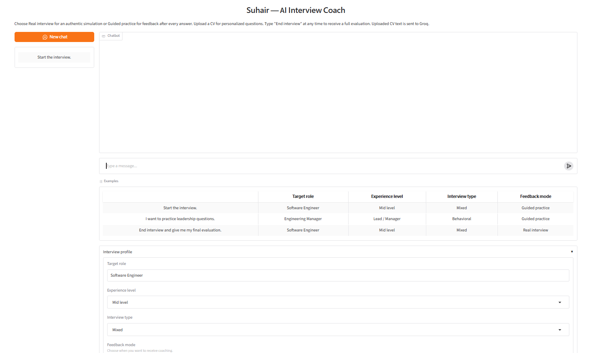
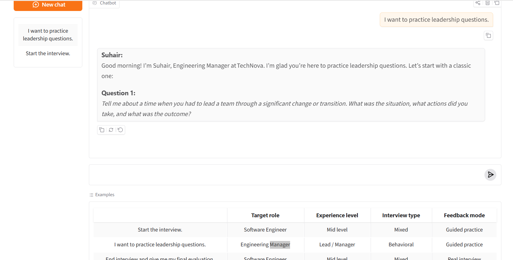
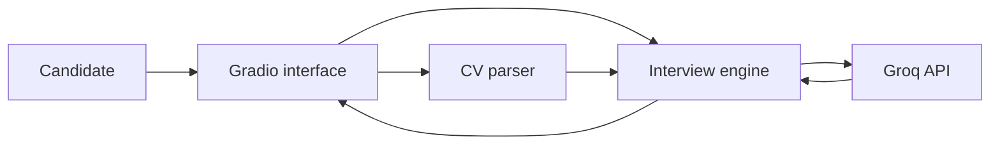

# Suhair — AI Interview Coach

An AI-powered mock interview application that creates role-specific questions,
uses a candidate's CV for personalization, and provides actionable feedback.
It supports both realistic interview simulations and guided practice.

## Features

- Real interview mode with feedback at the end
- Guided practice mode with feedback after every answer
- PDF, DOCX, and TXT CV parsing
- Questions tailored to role, seniority, interview type, and CV content
- Weighted scoring rubric across five interview competencies
- Final report with strengths, improvements, and a better answer example
- Defensive file limits, prompt-injection guidance, and provider error handling

## Screenshots

### Home



### Guided interview feedback



## Architecture



- `app.py` loads configuration and starts the application.
- `src/ui.py` defines the Gradio interface and user-facing error handling.
- `src/interviewer.py` builds prompts, applies feedback policies, and calls Groq.
- `src/resume.py` validates and extracts CV text.
- `tests/` verifies résumé parsing and interview prompt behavior.

## Local setup

Requires Python 3.12 or later.

```powershell
python -m venv .venv
.\.venv\Scripts\Activate.ps1
pip install -r requirements.txt
Copy-Item .env.example .env
```

Add your Groq API key to `.env`:

```env
GROQ_API_KEY=your_groq_api_key
GROQ_MODEL=openai/gpt-oss-120b
```

Start the application:

```powershell
python app.py
```

Open `http://127.0.0.1:7860`.

## Development

Install development dependencies and run the quality checks:

```powershell
pip install -r requirements-dev.txt
ruff check .
pytest
```

## Scoring

Answers are assessed using a weighted rubric:

- Role knowledge: 25%
- Relevance: 20%
- Communication: 20%
- Evidence and impact: 20%
- Reasoning: 15%

The score is coaching guidance, not an employment decision.

## Privacy

CV text and chat messages are sent to Groq to generate interview responses.
The application does not intentionally persist uploaded CV text, and `.env` is
excluded from version control. Users should remove unnecessary sensitive
information before uploading a CV.

## Current limitations

- Scoring is generated by an LLM and can vary between runs.
- Scanned PDFs require OCR before upload.
- Conversation history is limited to the most recent 24 messages.
- Interviews and reports are not yet saved between sessions.

## Roadmap

- Job-description matching
- Saved interview history and progress tracking
- Downloadable reports
- Voice interview mode
- Structured provider output and scoring validation
